# Track: LLM Fine-Tuning, PEFT & Alignment

> **"Don't simplify the topic. Simplify the path to understanding it."**

This track takes you from the raw linear algebra of weight matrices and low-rank factorization to production-grade parameter-efficient fine-tuning (LoRA / QLoRA), full fine-tuning (FFT), supervised fine-tuning (SFT), and modern reinforcement learning alignment (DPO, GRPO, PPO)—not by treating libraries as black boxes, but by understanding the exact mathematical, architectural, and memory mechanics behind each technique.

---

## 🧭 The 6-Stage Modular Progression

To prevent cognitive overload, this track is organized into **focused, dedicated notebooks** matching the 6-stage engineering progression:

$$\text{Understand} \longrightarrow \text{Build} \longrightarrow \text{Break} \longrightarrow \text{Introduce Tools} \longrightarrow \text{Apply} \longrightarrow \text{Revisit}$$

```mermaid
flowchart TD
    subgraph P1 ["Phase 1: UNDERSTAND (First Principles & Theory)"]
        U1["01: Vectors, Matrices & The Rank of Information"]
        U2["02: Full Fine-Tuning (FFT) vs PEFT & Memory Math"]
        U3["03: Supervised Fine-Tuning (SFT) Mechanics & Loss Math"]
        U4["04: The Alignment & RL Landscape (DPO, GRPO, PPO)"]
        U5["05: The Architectural Decision Matrix & SLM Simulator"]
    end

    subgraph P2 ["Phase 2: BUILD (Zero-Dependency Construction)"]
        B1["06: Building LoRALinear from Scratch in Pure PyTorch"]
    end

    subgraph P3 ["Phase 3: BREAK (Diagnostic Engineering)"]
        BR1["07: The Prompt Parrot Bug (Contaminated Loss Masking)"]
        BR2["08: Catastrophic Forgetting & Rank Sensitivity"]
        BR3["09: Chat Template Drift & Special Token Leaks"]
    end

    subgraph P4 ["Phase 4: INTRODUCE TOOLS (Production Ecosystem)"]
        T1["10: Hugging Face PEFT Deep-Dive"]
        T2["11: Modern SFT with trl & SFTTrainer"]
        T3["12: 4-Bit NormalFloat Quantization & QLoRA"]
    end

    subgraph P5 ["Phase 5: APPLY (Production Projects & Serving)"]
        A1["13: Fine-Tuning an SLM for Deterministic JSON Incident Triage"]
        A2["14: Preference Alignment with DPO (Chosen vs Rejected)"]
        A3["15: Rule-Based Reinforcement Learning with GRPO"]
        A4["16: Adapter Fusion, GGUF Export & Ollama Local Serving"]
    end

    subgraph P6 ["Phase 6: REVISIT (Recall & Assessment)"]
        R1["comfort-refresh.md (Standalone 3-Minute Quick Reference)"]
        R2["quizzes/ (Self-Assessment Question Banks)"]
    end

    P1 --> P2 --> P3 --> P4 --> P5 --> P6
```

---

## ⚡ Zero-Friction Refresher: `comfort-refresh.md`

When returning to this track after weeks or months, you don't need to re-run training loops or wait for models to download. Open the standalone reference:

👉 **[comfort-refresh.md](./comfort-refresh.md)**
* 30-second mental models & matrix factorization diagrams
* The 2D Orthogonal Grid: Training Objective (SFT/DPO) vs. Parameter Strategy (FFT/LoRA/QLoRA)
* Copy-paste production code recipes for PyTorch, `peft`, `trl`, and GGUF export
* The "Break" diagnostic cheat sheet (prompt parrot fix, forgetting fixes, special token fixes)
* Hardware memory rule-of-thumb estimators ($16\text{ bytes/param}$ vs. $2\text{ bytes/param}$ vs. $0.6\text{ bytes/param}$)

---

## 📚 Complete Curriculum & Notebook Directory

### Phase 1: UNDERSTAND (First Principles & Theory)
| Notebook | Title & Focus | Hands-on Concepts | Est. Time |
|---|---|---|:---:|
| **01** | **Vectors, Matrices & The Rank of Information** | Linear transformations ($y = xW^T$) ➔ visual rank intuition ($2 \times 2$ & $3 \times 3$ toy matrices) ➔ why low-rank factorization ($B \times A$) turns 9 numbers into 6 numbers. | [`01_vectors_matrices_and_rank.ipynb`](./01_vectors_matrices_and_rank.ipynb) | ~1.0h |
| **02** | **Full Fine-Tuning (FFT) vs PEFT & Memory Math** | What FFT actually does (`requires_grad=True` on all weights) ➔ the 2D orthogonal matrix (Objective vs Weight Update) ➔ the $16\text{ bytes/param}$ memory math breakdown (Weights + Gradients + Adam $m, v$ buffers). | [`02_fft_vs_peft_and_memory_math.ipynb`](./02_fft_vs_peft_and_memory_math.ipynb) | ~1.5h |
| **03** | **SFT Mechanics & Loss Math** | Autoregressive language modeling ➔ cross-entropy loss formula from scratch ➔ token shifting (`logits[:-1]` vs `labels[1:]`) ➔ how SFT transforms raw autocompleters into helpful assistants. | [`03_sft_mechanics_and_loss_math.ipynb`](./03_sft_mechanics_and_loss_math.ipynb) | ~1.5h |
| **04** | **The Alignment & RL Landscape (DPO, GRPO, PPO)** | The 4 training signals compared: SFT (demonstrations), DPO (preference pairs), GRPO (verifiable rule rewards), PPO (critic value networks) ➔ mathematical formulation of each. | [`04_alignment_and_rl_landscape.ipynb`](./04_alignment_and_rl_landscape.ipynb) | ~2.0h |
| **05** | **The Architectural Decision Matrix & SLM Simulator** | The SLM Change Simulator ➔ When to Prompt vs RAG vs Tool vs SFT/DPO/GRPO ➔ 5 real-world engineering case studies with hardware feasibility checks. | [`05_the_architectural_decision_matrix.ipynb`](./05_the_architectural_decision_matrix.ipynb) | ~1.5h |

### Phase 2: BUILD (Zero-Dependency Construction)
| Notebook | Title & Focus | Hands-on Concepts | Est. Time |
|---|---|---|:---:|
| **06** | **Building LoRALinear from Scratch in Pure PyTorch** | Build a complete `LoRALinear` module in pure PyTorch ➔ freeze base weights ➔ initialize $B=0$ and $A \sim \mathcal{N}$ ➔ the $\frac{\alpha}{r}$ scaling constant ➔ verify gradient isolation on a custom training loop. | [`06_lora_from_scratch_pure_pytorch.ipynb`](./06_lora_from_scratch_pure_pytorch.ipynb) | ~2.0h |

### Phase 3: BREAK (Diagnostic Engineering)
| Notebook | Title & Focus | Hands-on Concepts | Est. Time |
|---|---|---|:---:|
| **07** | **The Prompt Parrot Bug (Contaminated Loss Masking)** | Train without prompt masking ➔ observe the model collapse into repeating prompts ➔ inspect raw token IDs ➔ enforce completion-only `-100` label masking. | [`07_break_the_prompt_parrot.ipynb`](./07_break_the_prompt_parrot.ipynb) | ~1.5h |
| **08** | **Catastrophic Forgetting & Rank Sensitivity** | Over-train on narrow domain data ➔ probe off-task capabilities (basic arithmetic, general chat) ➔ rank ablation sweep ($r=1$ vs $r=8$ vs $r=64$). | [`08_break_catastrophic_forgetting.ipynb`](./08_break_catastrophic_forgetting.ipynb) | ~1.5h |
| **09** | **Chat Template Drift & Special Token Leaks** | Manual string concatenation crashes ➔ Jinja2 chat templates ➔ token boundary splitting ➔ diagnose and fix `<\|im_start\|>` and `<\|im_end\|>` leakage. | [`09_break_chat_templates_and_special_tokens.ipynb`](./09_break_chat_templates_and_special_tokens.ipynb) | ~1.5h |

### Phase 4: INTRODUCE TOOLS (Production Ecosystem)
| Notebook | Title & Focus | Hands-on Concepts | Est. Time |
|---|---|---|:---:|
| **10** | **Hugging Face PEFT Deep-Dive** | `LoraConfig` deep-dive ➔ target module selection (`q_proj`, `v_proj` vs all linear layers) ➔ saving and hot-swapping adapters at runtime. | [`10_tools_huggingface_peft.ipynb`](./10_tools_huggingface_peft.ipynb) | ~1.5h |
| **11** | **Modern SFT with trl & SFTTrainer** | `SFTTrainer` and `SFTConfig` ➔ `DataCollatorForCompletionOnlyLM` ➔ gradient accumulation and memory optimization. | [`11_tools_trl_and_sft_trainer.ipynb`](./11_tools_trl_and_sft_trainer.ipynb) | ~1.5h |
| **12** | **4-Bit NormalFloat Quantization & QLoRA** | FP32 to INT4 quantization mechanics ➔ double quantization ➔ paged optimizers with `bitsandbytes`. | [`12_tools_qlora_and_bitsandbytes.ipynb`](./12_tools_qlora_and_bitsandbytes.ipynb) | ~1.5h |

### Phase 5: APPLY (Production Projects & Serving)
| Notebook | Title & Focus | Hands-on Concepts | Est. Time |
|---|---|---|:---:|
| **13** | **Fine-Tuning an SLM for Incident Triage** | Fine-tune `Qwen2.5-0.5B` locally to route noisy SRE alerts to 15 issue labels & 4 teams in strict JSON ➔ evaluate `format_ok`, `team_acc`, `issue_acc`, and token savings. | [`13_apply_production_sft_slm.ipynb`](./13_apply_production_sft_slm.ipynb) | ~2.5h |
| **14** | **Preference Alignment with DPO** | Train with `DPOTrainer` on chosen vs. rejected pairs ➔ eliminate hallucinations and enforce deterministic operational tone. | [`14_apply_preference_alignment_dpo.ipynb`](./14_apply_preference_alignment_dpo.ipynb) | ~2.0h |
| **15** | **Rule-Based Reinforcement Learning with GRPO** | Group Relative Policy Optimization from scratch ➔ score completions with verifiable rule checkers without a neural reward model. | [`15_apply_reinforcement_learning_grpo.ipynb`](./15_apply_reinforcement_learning_grpo.ipynb) | ~2.0h |
| **16** | **Adapter Fusion, GGUF Export & Ollama Serving** | Merge LoRA weights back into the base model (`merge_and_unload`) ➔ convert to GGUF format ➔ deploy to Ollama and test with an OpenAI-compatible endpoint. | [`16_apply_adapter_fusion_gguf_and_ollama.ipynb`](./16_apply_adapter_fusion_gguf_and_ollama.ipynb) | ~2.0h |

---

## 🛠️ Quickstart & Local Execution

All notebooks are designed to run locally in **2–5 minutes** on:
* **Apple Silicon (M1/M2/M3/M4):** native hardware acceleration via PyTorch `mps`.
* **Standard Laptop / Desktop CPU:** using lightweight, modern open-weights models (`Qwen2.5-0.5B` and `SmolLM2-135M`).
* **Free Google Colab (Optional):** Pre-configured badges for users who want to scale up to 7B/8B models on a free T4 GPU.
